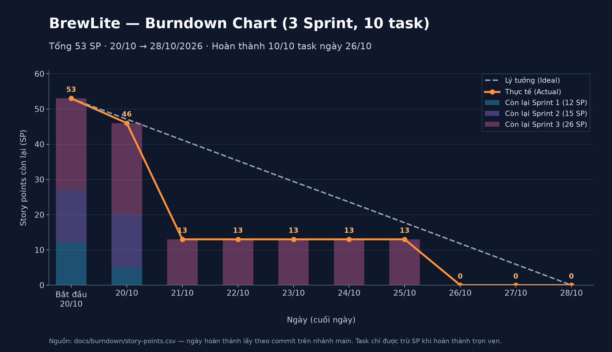

# Tài liệu Scrum - BrewLite

## 1. Vai trò
| Vai trò | Họ tên | MSSV | Phụ trách |
|---|---|---|---|
| Developer chính | Nguyễn Phạm Thái Tú | 3124410385 | Code, Docker, Git, kiểm thử tự động |
| Scrum Master | Quách Văn Trường | 3124410384 | Daily Scrum, Burndown, Review, Retrospective |
| Product Owner | Đặng Tuấn Vỹ | 3124410412 | Backlog, nghiệm thu, phản hồi |
| Tester | La Hữu Mẫn | 3122410235 | Test luồng chính |
| Tester, Reviewer | Quách Anh Vũ | 3124410410 | Test trường hợp lỗi, review Pull Request |
| Tài liệu, Demo | Trần Minh Trí | 3124410371 | README, slide, dẫn demo |

## 2. Product Backlog

**Trạng thái: 10/10 task đã hoàn thành.** Bảng dưới đây là bộ story points (SP) chính thức nhóm dùng để theo dõi tiến độ và vẽ Burndown.

"Điểm chấm bài" giữ nguyên 1 điểm/task theo đề. "Story points" đo quy mô công việc tương đối (khối lượng, độ phức tạp, rủi ro). Hai cột có mục đích khác nhau nên không cộng lẫn.

"Ngày hoàn thành" là ngày code của task được đưa lên nhánh `main`. Cột cuối là mã commit để thầy/nhóm kiểm tra lại trên GitHub.

<!-- sp-table:start -->
| # | Task | Sprint | Điểm chấm bài | Story points | Trạng thái | Ngày hoàn thành | Commit minh chứng |
|---|---|---|---|---|---|---|---|
| 1 | Khởi tạo dự án và cấu trúc | 1 | 1 | 2 | Hoàn thành | 20/10/2026 | `14e3b4c + 1f8a181` |
| 2 | API danh sách sản phẩm | 1 | 1 | 2 | Hoàn thành | 20/10/2026 | `46b3ca3` |
| 3 | Trang Menu | 1 | 1 | 3 | Hoàn thành | 20/10/2026 | `76002ae` |
| 4 | Chi tiết và tùy chọn sản phẩm | 1 | 1 | 5 | Hoàn thành | 21/10/2026 | `575dfc5` |
| 5 | Giỏ hàng | 2 | 1 | 5 | Hoàn thành | 21/10/2026 | `575dfc5` |
| 6 | API tạo đơn hàng | 2 | 1 | 5 | Hoàn thành | 21/10/2026 | `4b5237e` |
| 7 | Đăng ký / Đăng nhập JWT | 2 | 1 | 5 | Hoàn thành | 21/10/2026 | `d491869 + e4ea0fc` |
| 8 | Thanh toán không tiền mặt | 3 | 1 | 5 | Hoàn thành | 21/10/2026 | `6abfdcc + 3ca42b2` |
| 9 | Xác nhận, lịch sử đơn và bàn giao | 3 | 1 | 8 | Hoàn thành | 21/10/2026 | `9d1e1e0 + 41cc986 + 7a5329f` |
| 10 | Nghiệp vụ backend nâng cao | 3 | 1 | 13 | Hoàn thành | 26/10/2026 | `517633a → 62fba46` |
| **Tổng** | **10 task** | **3 Sprint** | **10** | **53** | **10/10 hoàn thành** | | |
<!-- sp-table:end -->

Ảnh giao diện tham khảo: [img.png](img.png).

### 2.1. Cách xác định story points

1. Đọc tiêu chí chấp nhận của từng task; tính cả lập trình, tích hợp và kiểm thử cần để hoàn thành.
2. Dùng Task 2 (API đọc danh sách sản phẩm) làm mốc 2 SP. So sánh các task còn lại theo phạm vi, số thành phần liên quan, độ khó và rủi ro; không quy đổi SP cố định sang giờ.
3. Dùng thang Fibonacci 1, 2, 3, 5, 8, 13. Task 1 ngang mốc (2 SP). Task 3 lớn hơn mốc một chút (3 SP). Các luồng tùy chọn/giỏ hàng/tạo đơn/xác thực/thanh toán cơ bản ở mức 5 SP. Task 9 có phạm vi tích hợp và bàn giao rộng nên 8 SP.
4. Task 10 được 13 SP vì gộp state machine, idempotency, khóa tồn kho đồng thời, khuyến mãi/điểm thưởng và kiểm thử nghiệp vụ. Task 6 và 8 chỉ tính luồng cơ bản; phần nâng cao tính ở Task 10 để tránh đếm trùng.
5. Các thành viên cùng xem xét và thống nhất; Scrum Master ghi nhận kết quả, Product Owner làm rõ phạm vi.

Lý do từng ước lượng được lưu cùng dữ liệu trong [story-points.csv](burndown/story-points.csv). Tham khảo phương pháp: [Atlassian - Story points and estimation](https://www.atlassian.com/agile/project-management/estimation) và [Scrum Guide - Product Backlog](https://scrumguides.org/scrum-guide.html#product-backlog).

## 3. Sprint Backlog và Sprint Goal
- **Sprint 1** (Task 1-4): Nền tảng và hiển thị menu.
- **Sprint 2** (Task 5-7): Giỏ hàng, đặt đơn, đăng nhập. Thực tế làm theo thứ tự 5 → 7 → 6 vì Task 6 cần JWT Guard của Task 7.
- **Sprint 3** (Task 8-10): Thanh toán, bàn giao, nghiệp vụ nâng cao.

Tổng SP theo Sprint (cả 3 Sprint đều đã đạt Sprint Goal):

<!-- sp-totals:start -->
- **Sprint 1: 12 SP** — hoàn thành ngày 21/10/2026.
- **Sprint 2: 15 SP** — hoàn thành ngày 21/10/2026.
- **Sprint 3: 26 SP** — hoàn thành ngày 26/10/2026.
- **Toàn bộ backlog: 53 SP** (tách biệt với 10 điểm chấm bài).
<!-- sp-totals:end -->

## 4. Daily Scrum

### Ghi nhận cuộc họp thứ Hai, 26/10/2026

- Thời lượng: 15 phút.
- Nội dung thực tế: trao đổi và phân công công việc cho các thành viên.
- Tiến độ tại thời điểm họp: các đầu việc mới được giao chưa bắt đầu thực hiện.

| Ngày | Đã làm | Sẽ làm | Vướng mắc |
|---|---|---|---|
| 26/10/2026 (Thứ Hai) | Đã họp nhóm 15 phút và thống nhất phân công công việc; chưa triển khai các đầu việc mới tại thời điểm họp. | Các thành viên bắt đầu thực hiện nhiệm vụ đã nhận. Trường viết unit test cho `vnd()` và `cartCount()`, theo dõi Daily và chuẩn bị Burndown. | Chưa có thông tin được xác nhận về vướng mắc trong buổi họp. |

### Cập nhật công việc thứ Ba, 27/10/2026

- Nguồn ghi nhận: nội dung 4 thành viên gửi cho Scrum Master và đối chiếu mã nguồn trên nhánh `main`.
- Đây là bản tổng hợp thông tin đã nhận. Giờ họp, thời lượng thực tế và danh sách người tham dự Daily thứ Ba chưa được cung cấp để bổ sung vào biên bản.
- Các mô tả kiểm thử dưới đây là phạm vi công việc thành viên gửi; kết quả Đạt/Không đạt hoặc PASS/FAIL chỉ được ghi nhận khi có báo cáo thực tế.

| Thành viên | Nội dung đã nhận | Đối chiếu repository | Việc tiếp theo / thông tin cần bổ sung |
|---|---|---|---|
| La Hữu Mẫn - Tester luồng chính | Hiện nhãn "Hết hàng", khóa nút "Thêm vào giỏ" khi stock = 0; kiểm thử đổi size/topping, giỏ hàng, đăng ký email mới, thanh toán Ví và "Đơn của tôi". Phạm vi nghiệm thu: Task 3, 4, 5, 8, 9. | `frontend/src/app/products/[id]/page.tsx` đã có kiểm tra `stock <= 0`, nhãn hết hàng và khóa/chặn thêm vào giỏ trên `main`. | Bổ sung bảng Đạt/Không đạt cho từng bước đã chạy và ảnh lỗi nếu có. Nội dung đã nhận chưa kèm kết quả kiểm thử từng bước. |
| Quách Anh Vũ - Tester lỗi, Reviewer | Bổ sung `backend/http/api.http`; kiểm thử đăng ký trùng email, sai mật khẩu, giỏ rỗng, mã sai/BREW10, thanh toán thành công/thất bại, dùng lại Idempotency-Key và thanh toán lại sau lỗi; review/Approve các PR. Phạm vi nghiệm thu: Task 6, 7, 8, 9, 10. | File HTTP đã có các request mẫu và kết quả mong đợi; PR #3 đã merge vào `main`. Chưa có review/Approve được ghi nhận trên GitHub ở PR #1-#4 tại thời điểm đối chiếu. | Bổ sung bảng PASS/FAIL thực tế và ghi nhận review theo phân công. Request mẫu và trạng thái PR đã merge chưa thay thế cho kết quả chạy test hoặc xác nhận review. |
| Đặng Tuấn Vỹ - Product Owner | Thêm tìm món theo tên trên Menu, lọc phía trình duyệt; nghiệm thu Task 1, 2, 3, 4, 8, 9; viết phản hồi khách hàng và backlog bản sau. | Tìm kiếm đã có trong `frontend/src/app/page.tsx`; PR #4 đã merge. Mục 10 đã có nghiệm thu sơ bộ dựa trên source, phản hồi mô phỏng và backlog. | Xác nhận kết quả chạy thực tế trước khi chốt nghiệm thu; bổ sung phản hồi thực tế sau Review nếu có. Giữ rõ phạm vi đánh giá sơ bộ của mục 10. |
| Trần Minh Trí - Tài liệu, Demo | Thêm trang 404 tiếng Việt, footer gắn vào layout; cập nhật tên/MSSV và hướng dẫn README theo thay đổi code. Hoàn thành bộ nghiệp vụ quản lý tồn kho nguyên liệu, kiểm soát định lượng thời gian thực, báo cáo cân đối xuất-nhập-tồn, chỉnh sửa công thức, kiểm soát nguyên liệu dùng chung. | `not-found.tsx`, `footer.tsx` và phần gắn Footer vào `layout.tsx` đã có trên `main`; PR #1 đã merge. README đã có tên/MSSV các thành viên và nội dung chức năng mới. | Bộ quản lý tồn kho nguyên liệu đã merge qua PR #5 ngày 02/11/2026 (phần mở rộng ngoài 10 task, xem mục 10.2). |

**Cập nhật phần việc Scrum Master - Quách Văn Trường:** PR #2 đã merge vào `main`, gồm 12 unit test cho `vnd()` và `cartCount()`, hướng dẫn chạy test và ghi nhận buổi họp thứ Hai. Khi tích hợp với thay đổi mới của nhóm, 12 test, lint và build đã chạy thành công. Đã chốt bộ story points (mục 2) và vẽ Burndown theo ngày hoàn thành thực tế của từng task (mục 5).

### Tình trạng hiện tại (03/11/2026)

- **10/10 task trong Product Backlog đã hoàn thành**: Sprint 1 xong 21/10, Sprint 2 xong 21/10, Sprint 3 xong 26/10/2026. Còn lại 0 SP.
- Các PR #1–#4 đã merge ngày 27/10/2026, PR #5 (tồn kho nguyên liệu, phần mở rộng) đã merge ngày 02/11/2026.
- 28/10/2026: chỉnh giao diện (màu nút size/topping, trang xác nhận, lịch sử đơn, checkout, menu) theo màu header.
- 03/11/2026: Trí hoàn thiện README (chức năng mới, kịch bản demo, tài khoản thử nghiệm).
- Không còn vướng mắc chặn tiến độ.

## 5. Burndown

**Trạng thái: đã có Burndown thực tế.** Biểu đồ có đủ 2 đường Lý tưởng (Ideal) và Thực tế (Actual), trục X theo ngày thật từ 20/10 đến 28/10/2026 (Sprint Review).



### 5.1. Cách đọc biểu đồ

- **Trục Y:** số story points **còn lại** (chưa làm xong). Bắt đầu ở 53 SP (tổng 10 task).
- **Trục X:** các ngày, điểm đầu tiên là lúc bắt đầu 20/10, mỗi điểm sau là **cuối ngày** đó.
- **Đường nét đứt xám (Lý tưởng):** nếu nhóm làm đều tay mỗi ngày thì SP giảm theo đường thẳng từ 53 về 0 vào ngày 28/10.
- **Đường cam (Thực tế):** SP còn lại thật ở cuối mỗi ngày, tính từ ngày hoàn thành của từng task ở mục 2.
- **Cột màu chồng nhau:** phần SP còn lại thuộc Sprint 1 (xanh), Sprint 2 (tím), Sprint 3 (hồng). Nhìn cột sẽ biết ngày đó Sprint nào còn việc.

### 5.2. Cách tính

- `S` = 53 SP, `D` = 9 ngày (20/10 → 28/10), `d` = số ngày đã qua.
- **Lý tưởng** = `S × (1 − d / D)`. Ví dụ cuối ngày 21/10 (d = 2): 53 × (1 − 2/9) ≈ 41.2 SP.
- **Thực tế** = tổng SP của các task **chưa** hoàn thành tính đến cuối ngày. Task chỉ được trừ khi xong trọn vẹn (không trừ theo phần trăm cảm tính).
- Ví dụ: cuối 20/10 xong Task 1, 2, 3 (2 + 2 + 3 = 7 SP) nên còn 53 − 7 = 46 SP.

<!-- burndown-daily:start -->
| Thời điểm | Task hoàn thành trong ngày | SP trừ | Còn lại S1 | Còn lại S2 | Còn lại S3 | Lý tưởng | **Thực tế** |
|---|---|---|---|---|---|---|---|
| Bắt đầu 20/10 | — | 0 | 12 | 15 | 26 | 53 | **53** |
| Cuối 20/10 | Task 1, Task 2, Task 3 | 7 | 5 | 15 | 26 | 47.1 | **46** |
| Cuối 21/10 | Task 4, Task 5, Task 6, Task 7, Task 8, Task 9 | 33 | 0 | 0 | 13 | 41.2 | **13** |
| Cuối 22/10 | — | 0 | 0 | 0 | 13 | 35.3 | **13** |
| Cuối 23/10 | — | 0 | 0 | 0 | 13 | 29.4 | **13** |
| Cuối 24/10 | — | 0 | 0 | 0 | 13 | 23.6 | **13** |
| Cuối 25/10 | — | 0 | 0 | 0 | 13 | 17.7 | **13** |
| Cuối 26/10 | Task 10 | 13 | 0 | 0 | 0 | 11.8 | **0** |
| Cuối 27/10 | — | 0 | 0 | 0 | 0 | 5.9 | **0** |
| Cuối 28/10 | — | 0 | 0 | 0 | 0 | 0 | **0** |
<!-- burndown-daily:end -->

### 5.3. Nhận xét tiến độ

- **Đường Thực tế luôn nằm dưới hoặc bằng đường Lý tưởng:** nhóm làm nhanh hơn kế hoạch. Riêng ngày 21/10 xong 6 task (Task 4–9, 33 SP), hoàn thành trọn Sprint 1 và Sprint 2.
- **Ngày 22–25/10 đường Thực tế đi ngang ở 13 SP:** chỉ còn Task 10 (13 SP, lớn nhất). Ngày 24/10 đã làm state machine và idempotency nhưng Task 10 chưa xong trọn nên chưa được trừ SP.
- **Ngày 26/10 về 0:** Task 10 xong (khóa tồn kho, khuyến mãi, test tích hợp). Toàn bộ backlog hoàn thành **sớm 2 ngày** so với mốc Review 28/10.
- **Bài học cho Retrospective:** Task 10 quá lớn (13 SP) làm đường Thực tế đi ngang 4 ngày. Lần sau nên tách thành các task nhỏ (state machine, idempotency, tồn kho, khuyến mãi) để theo dõi tiến độ sát hơn.

### 5.4. Dữ liệu và vẽ lại ảnh

Dữ liệu: [story-points.csv](burndown/story-points.csv) (SP, Sprint, ngày hoàn thành, commit minh chứng của từng task). Script tự cập nhật bảng ở mục 2, mục 3, mục 5.2 và vẽ lại `burndown.png`:

```bash
python -m pip install -r docs/burndown/requirements.txt
python docs/burndown/generate_charts.py
```

## 6. Sprint Review

**Lịch: sáng thứ Tư, 28/10/2026.** Kết quả bàn giao (Increment) của cả 3 Sprint đã có trên nhánh `main`:

| Sprint | Sprint Goal | SP | Kết quả |
|---|---|---|---|
| 1 | Nền tảng và hiển thị menu | 12 | Đạt — xong 21/10 |
| 2 | Giỏ hàng, đặt đơn, đăng nhập | 15 | Đạt — xong 21/10 |
| 3 | Thanh toán, bàn giao, nghiệp vụ nâng cao | 26 | Đạt — xong 26/10 |

Kịch bản demo theo từng Sprint:

| Phạm vi | Kịch bản demo | Bằng chứng trình bày |
|---|---|---|
| Sprint 1 - Task 1-4 | Khởi động dự án; gọi API menu; tìm món; mở chi tiết và đổi size/topping để kiểm tra giá. | App/API chạy được, dữ liệu món thật, kết quả kiểm thử các lựa chọn. |
| Sprint 2 - Task 5-7 | Thêm/sửa/xóa giỏ hàng; đăng ký/đăng nhập; tạo đơn với giỏ hợp lệ và kiểm tra giỏ rỗng. | Bảng test của tester, phản hồi API, mã đơn thật và trạng thái PENDING. |
| Sprint 3 - Task 8-10 | Thanh toán mô phỏng thành công/thất bại; thử lại; xác nhận/lịch sử đơn; kiểm thử trạng thái đơn, idempotency và tồn kho đồng thời. | Kết quả test, mã đơn/trạng thái thật, log hoặc ảnh minh chứng và lệnh chạy Docker/README. |

- Trí dẫn demo; Tú hỗ trợ kỹ thuật; Trường điều phối và ghi nhận; Vỹ đối chiếu tiêu chí nghiệm thu; Mẫn và Vũ trình bày kết quả kiểm thử theo phân công.
- Sau Review, nhóm đã làm thêm: chỉnh giao diện theo màu header (28/10) và bộ quản lý tồn kho nguyên liệu (PR #5, 02/11) — các hạng mục mở rộng ở mục 10.2.
- Bảng ở mục 10 hiện là đánh giá sơ bộ dựa trên source; phản hồi tại mục 10.1 được ghi rõ là mô phỏng. Chỉ cập nhật thành phản hồi thực tế khi đã nhận được trong Review.

## 7. Retrospective

**Dự kiến thực hiện sau Review sáng 28/10/2026. Các mục dưới đây là nội dung gợi ý để nhóm thảo luận, chưa phải kết luận của một cuộc họp đã diễn ra.**

- **Cơ sở thảo luận về điều làm tốt:** các phần code đã được tích hợp vào `main`; có unit test frontend và hướng dẫn chạy; đã tổng hợp phân công và thông tin thành viên gửi. Nhóm cần tự xác nhận điều gì thực sự giúp phối hợp hiệu quả.
- **Vấn đề cần xem xét (rút ra từ Burndown và GitHub):**
  - Task 10 quá lớn (13 SP) nên đường Thực tế đi ngang 4 ngày (22–25/10), khó theo dõi tiến độ. Lần sau tách nhỏ thành các task ≤ 5 SP.
  - Khối lượng dồn vào ngày 21/10 (33 SP trong 1 ngày) — nên chia việc đều hơn trong Sprint.
  - PR #1–#5 được merge nhưng chưa có lượt review/Approve trên GitHub.
  - Chưa có bảng PASS/FAIL thực tế của tester được lưu lại trong repo.
- **Cách chốt cải tiến:** chọn các vấn đề quan trọng, thống nhất hành động có người phụ trách và thời hạn; ghi lại quyết định thực tế sau họp.

| Hành động cải tiến đề xuất | Người dự kiến phụ trách | Mốc đề xuất |
|---|---|---|
| Thống nhất ước lượng, phạm vi Sprint và ghi SP còn lại mỗi ngày. | Nhóm thực hiện công việc cùng Scrum Master; PO làm rõ phạm vi. | Sprint Planning tiếp theo và cuối mỗi ngày làm việc. |
| Lưu bảng kết quả kiểm thử và ảnh lỗi tại nơi nhóm cùng truy cập được. | Mẫn, Vũ. | Trước khi chốt nghiệm thu hạng mục. |
| Ghi nhận review trên Pull Request trước khi merge. | Reviewer được phân công, gồm Vũ đối với PR của thành viên khác. | Từng Pull Request tiếp theo. |

Các người phụ trách và mốc trên là đề xuất để nhóm xác nhận trong Retrospective, chưa được ghi là cam kết đã thông qua.

## 8. Definition of Done
- Code chạy được, không lỗi build, đúng tiêu chí chấp nhận.
- Commit rõ ràng, được review trong nhóm.
- API có validate, UI có loading/lỗi.
- README có hướng dẫn chạy.

**Cách áp dụng khi chốt nghiệm thu:**

| Tiêu chí | Bằng chứng hiện có | Phần cần xác nhận thêm |
|---|---|---|
| Code chạy/build được và đáp ứng tiêu chí chấp nhận. | 12 unit test frontend, lint và build đã chạy đạt khi tích hợp PR #2. | Test của hai helper không thay thế kiểm thử end-to-end, backend và từng task chức năng. |
| Commit rõ ràng, được review trong nhóm. | Có commit và các PR đã merge. | Lưu xác nhận review theo phân công; merge không tự chứng minh đã review/Approve. |
| API validate; UI có loading/lỗi. | Có DTO và xử lý trạng thái trong source. | Chạy các tình huống hợp lệ/lỗi và ghi kết quả thực tế. |
| Có hướng dẫn chạy trong README. | README có Docker, cách chạy local và lệnh test. | Đối chiếu lại hướng dẫn trên máy demo trước bàn giao. |

SP của hạng mục chỉ được tính hoàn thành khi có đủ bằng chứng đạt DoD theo quy ước nhóm đã xác nhận. Giữ riêng trạng thái có code, đã merge và đã nghiệm thu để báo cáo đúng tiến độ.

## 9. Ghi chú
- Task 4 commit chung với Task 5. Task 1 và Task 7 có 2 commit (backend/frontend riêng).
- Giả định (đề không quy định): giá size/topping, điểm thưởng 1 điểm/10.000đ, mã BREW10 giảm 10%, idempotency áp dụng cho POST /payments.

## 10. Nghiệm thu của Product Owner – Đặng Tuấn Vỹ

Phạm vi nghiệm thu: Task 1, 2, 3, 4, 8, 9 theo Product Backlog của đề bài BrewLite.

Đánh giá dựa trên việc rà soát source code và cấu hình repository. Các tiêu chí cần chạy thử thực tế phải được kiểm tra trước khi xác nhận hoàn tất Definition of Done.

| Task | Tiêu chí nghiệm thu | Kết quả | Căn cứ rà soát |
|---|---|---|---|
| 1 | Khởi tạo dự án, cấu trúc frontend Next.js và backend NestJS, README, Git, .env.example | Đạt | Có thư mục frontend/backend, README, file môi trường mẫu và cấu hình Docker Compose. Cần chạy thử trên máy demo. |
| 2 | API GET /products trả về danh sách sản phẩm gồm id, tên, giá và ảnh | Đạt | Backend có endpoint GET /products cung cấp dữ liệu menu. Cần kiểm tra phản hồi API thực tế. |
| 3 | Trang Menu gọi API, hiển thị sản phẩm, loading/empty state | Đạt | Trang frontend/src/app/page.tsx gọi API /products. Đã thêm ô tìm món theo tên, lọc trực tiếp trên trình duyệt và thông báo khi không có kết quả. |
| 4 | Trang chi tiết cho chọn size S/M/L và topping, tính giá theo lựa chọn | Đạt | Có trang chi tiết sản phẩm hỗ trợ chọn size, topping và tính giá. Cần kiểm thử các lựa chọn trước buổi demo. |
| 8 | Thanh toán Ví/Thẻ, gọi POST /payments, cập nhật PAID hoặc PAYMENT_FAILED | Đạt | Có chức năng thanh toán và lựa chọn phương thức. Cần chạy thử cả trường hợp thành công và thất bại. |
| 9 | Xác nhận đơn, lịch sử đơn, Docker Compose, README và demo end-to-end | Đạt | Có trang xác nhận đơn, trang lịch sử đơn, cấu hình Docker Compose và README. Cần chạy đủ dịch vụ và demo trọn luồng. |

### 10.1. Phản hồi khách hàng

Các nội dung dưới đây là phản hồi mô phỏng để chuẩn bị cho Sprint Review, không phải phản hồi đã được xác nhận từ khách hàng thật.

1. Giao diện menu hiển thị tên, hình ảnh và giá đồ uống rõ ràng. Chức năng tìm món theo tên giúp khách hàng tìm sản phẩm nhanh hơn.
2. Chức năng chọn size và topping giúp khách hàng tùy chỉnh đồ uống theo sở thích.
3. Luồng thanh toán Ví/Thẻ và màn hình xác nhận giúp khách hàng theo dõi kết quả đặt hàng.
4. Khi thanh toán thất bại, khách hàng mong muốn có thông báo rõ ràng và hướng dẫn thử lại an toàn.
5. Khách hàng đề nghị nhóm kiểm thử đầy đủ luồng đặt hàng, thanh toán và bàn giao trước khi đưa sản phẩm vào sử dụng.

### 10.2. Product Backlog và Tiến độ triển khai các tính năng mở rộng

| Ưu tiên | Hạng mục | Mục tiêu | Trạng thái ghi nhận |
|---|---|---|---|
| Đã hoàn thành | Quản lý định lượng & Tồn kho nguyên liệu (Ingredient Inventory) | Mô hình nguyên liệu (g, ml, pcs), công thức theo size S/M/L, công thức topping, giữ chỗ nguyên liệu trong 10 phút, đối soát biến động kho. | Đã hoàn thành (Code, Migration, Seed, Test E2E) |
| Đã hoàn thành | Dự báo cơ cấu bán hàng (Sales Mix Forecast 500+ ly) | Cho phép người quản lý nhập số ly dự kiến (500+ ly), tự động gộp nguyên liệu dùng chung và xuất bảng phân tích thiếu hụt không làm thay đổi tồn kho. | Đã hoàn thành (API, UI, E2E Test) |
| Đã hoàn thành | Cải thiện thông báo lỗi và thử lại khi thanh toán thất bại | Tái sử dụng đơn hàng cũ, cơ chế Idempotency-Key chống lặp, xử lý rõ ràng khi hết hạn giữ chỗ và hỗ trợ hủy đơn giải phóng giữ chỗ. | Đã hoàn thành |
| Đã hoàn thành | Báo cáo cân đối xuất-nhập-tồn hàng ngày | Báo cáo xuất-nhập-tồn theo múi giờ Asia/Ho_Chi_Minh (UTC+7), đối soát toán học chính xác 100%. | Đã hoàn thành |
| Cao | Lọc menu theo danh mục và khoảng giá | Giúp khách hàng tìm đồ uống nhanh hơn theo sở thích. | Đang chờ phiên bản kế tiếp |
| Trung bình | Lưu món yêu thích và đặt lại từ lịch sử đơn | Rút ngắn thời gian đặt hàng cho khách hàng thường xuyên. | Đang chờ phiên bản kế tiếp |
| Thấp | Cải thiện khả năng truy cập và giao diện trên thiết bị di động | Tối ưu hóa nâng cao trải nghiệm người dùng mobile. | Đang chờ phiên bản kế tiếp |

### 10.3. Ghi chú của Product Owner

- Kết quả Đạt trong bảng là đánh giá ban đầu dựa trên rà soát source code, chưa thay thế cho kiểm thử thực tế.
- Trước khi chốt nghiệm thu, cần chạy ứng dụng, kiểm tra tiêu chí chấp nhận, lưu bằng chứng kiểm thử và xác nhận commit/review theo Definition of Done.
- Phản hồi khách hàng mô phỏng cần được cập nhật bằng ý kiến thực tế nếu nhóm đã tổ chức Sprint Review.
