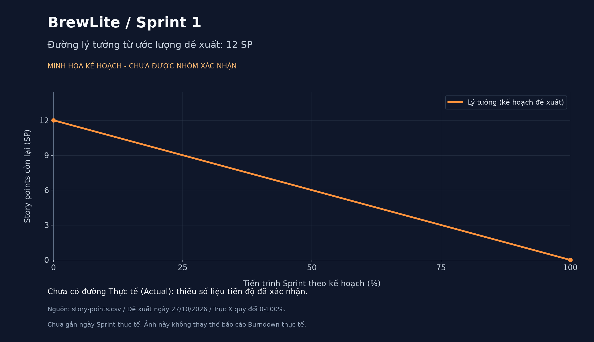
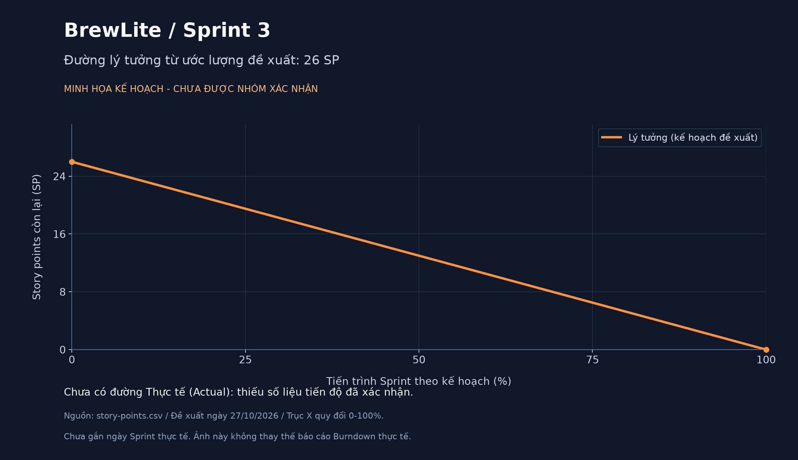

# Tài liệu Scrum - BrewLite

## 1. Vai trò
| Vai trò | Họ tên | MSSV | Phụ trách |
|---|---|---|---|
| Developer chính | Nguyễn Phạm Thái Tú | 3124410385 | Code, Docker, Git, kiểm thử tự động |
| Scrum Master | Quách Văn Trường | 3124410384 | Daily Scrum, Burndown, Review, Retrospective |
| Product Owner | Đặng Tuấn Vỹ | 3124410412 | Backlog, nghiệm thu, phản hồi |
| Tester | La Hữu Mẫn | 3122410235 | Test luồng chính |
| Tester, Reviewer | Quách Anh Vũ | 3124410410 | Test trường hợp lỗi, review Pull Request |
| Tài liệu, Demo | Trần Minh Trí | 3124410371 | README, slide, dẫn demo |

## 2. Product Backlog

**Bộ ước lượng đề xuất ngày 27/10/2026, chờ nhóm xác nhận.** Đây là ước lượng bổ sung sau khi mã nguồn đã được triển khai, không phải bằng chứng nhóm đã chốt SP từ đầu các Sprint.

"Điểm chấm bài" giữ nguyên 1 điểm/task theo đề. "SP đề xuất" đo quy mô công việc tương đối, gồm khối lượng, độ phức tạp và rủi ro; hai cột này có mục đích khác nhau.

<!-- proposed-sp-table:start -->
| # | Task | Sprint | Điểm chấm bài | SP đề xuất | Trạng thái ghi sẵn |
|---|---|---|---|---|---|
| 1 | Khởi tạo dự án và cấu trúc | 1 | 1 | 2 | Xong |
| 2 | API danh sách sản phẩm | 1 | 1 | 2 | Xong |
| 3 | Trang Menu | 1 | 1 | 3 | Xong |
| 4 | Chi tiết và tùy chọn sản phẩm | 1 | 1 | 5 | Xong |
| 5 | Giỏ hàng | 2 | 1 | 5 | Xong |
| 6 | API tạo đơn hàng | 2 | 1 | 5 | Xong |
| 7 | Đăng ký / Đăng nhập JWT | 2 | 1 | 5 | Xong |
| 8 | Thanh toán không tiền mặt | 3 | 1 | 5 | Xong |
| 9 | Xác nhận, lịch sử đơn và bàn giao | 3 | 1 | 8 | Xong |
| 10 | Nghiệp vụ backend nâng cao | 3 | 1 | 13 | Xong |
| **Tổng** | **10 task** | **3 Sprint** | **10** | **53** | |
<!-- proposed-sp-table:end -->

Trạng thái "Xong" được giữ từ bảng backlog có sẵn; cần đối chiếu Definition of Done và bằng chứng nghiệm thu trước khi kết luận hạng mục đã đạt đầy đủ. Ảnh giao diện tham khảo có sẵn: [img.png](img.png).

### 2.1. Cách xác định story points

1. Đọc tiêu chí chấp nhận của từng task; tính cả lập trình, tích hợp và kiểm thử cần để hoàn thành.
2. Dùng Task 2 (API đọc danh sách sản phẩm) làm mốc 2 SP. So sánh các task còn lại theo phạm vi, số thành phần liên quan, độ khó và rủi ro; không quy đổi SP cố định sang giờ.
3. Dùng thang tham chiếu 1, 2, 3, 5, 8, 13. Task 3 ở mức 3 SP; các luồng tùy chọn/giỏ hàng/tạo đơn/xác thực/thanh toán cơ bản ở mức 5 SP; Task 9 có phạm vi tích hợp và bàn giao rộng nên đề xuất 8 SP.
4. Task 10 đề xuất 13 SP vì kết hợp state machine, idempotency, tồn kho đồng thời, khuyến mãi/điểm thưởng và kiểm thử nghiệp vụ. Nên tách các phần này để nhóm thảo luận lại nếu cần. Task 6 và 8 chỉ tính luồng cơ bản; phần nâng cao được tính ở Task 10 để tránh đếm trùng.
5. Các thành viên thực hiện công việc cùng xem xét và thống nhất; Scrum Master ghi nhận kết quả, Product Owner làm rõ phạm vi. Bộ số hiện tại là đề xuất có căn cứ, chưa được ghi là quyết định của cả nhóm.

Lý do từng ước lượng được lưu cùng dữ liệu trong [story-points.csv](burndown/story-points.csv). Tham khảo phương pháp: [Atlassian - Story points and estimation](https://www.atlassian.com/agile/project-management/estimation) và [Scrum Guide - Product Backlog](https://scrumguides.org/scrum-guide.html#product-backlog).

## 3. Sprint Backlog và Sprint Goal
- **Sprint 1** (Task 1-4): Nền tảng và hiển thị menu.
- **Sprint 2** (Task 5-7): Giỏ hàng, đặt đơn, đăng nhập. Thực tế làm theo thứ tự 5 → 7 → 6 vì Task 6 cần JWT Guard của Task 7.
- **Sprint 3** (Task 8-10): Thanh toán, bàn giao, nghiệp vụ nâng cao.

Tổng dưới đây dùng bộ ước lượng đề xuất ở mục 2, chưa phải cam kết Sprint đã được nhóm xác nhận:

<!-- proposed-sp-totals:start -->
- **Sprint 1: 12 SP đề xuất.**
- **Sprint 2: 15 SP đề xuất.**
- **Sprint 3: 26 SP đề xuất.**
- **Toàn bộ backlog: 53 SP đề xuất**, tách biệt với 10 điểm chấm bài.
<!-- proposed-sp-totals:end -->

## 4. Daily Scrum

### Ghi nhận cuộc họp thứ Hai, 26/10/2026

- Thời lượng: 15 phút.
- Nội dung thực tế: trao đổi và phân công công việc cho các thành viên.
- Tiến độ tại thời điểm họp: các đầu việc mới được giao chưa bắt đầu thực hiện.

| Ngày | Đã làm | Sẽ làm | Vướng mắc |
|---|---|---|---|
| 26/10/2026 (Thứ Hai) | Đã họp nhóm 15 phút và thống nhất phân công công việc; chưa triển khai các đầu việc mới tại thời điểm họp. | Các thành viên bắt đầu thực hiện nhiệm vụ đã nhận. Trường viết unit test cho `vnd()` và `cartCount()`, theo dõi Daily và chuẩn bị Burndown. | Chưa có thông tin được xác nhận về vướng mắc trong buổi họp. |

### Cập nhật công việc thứ Ba, 27/10/2026

- Nguồn ghi nhận: nội dung 4 thành viên gửi cho Scrum Master và đối chiếu mã nguồn trên nhánh `main`.
- Đây là bản tổng hợp thông tin đã nhận. Giờ họp, thời lượng thực tế và danh sách người tham dự Daily thứ Ba chưa được cung cấp để bổ sung vào biên bản.
- Các mô tả kiểm thử dưới đây là phạm vi công việc thành viên gửi; kết quả Đạt/Không đạt hoặc PASS/FAIL chỉ được ghi nhận khi có báo cáo thực tế.

| Thành viên | Nội dung đã nhận | Đối chiếu repository | Việc tiếp theo / thông tin cần bổ sung |
|---|---|---|---|
| La Hữu Mẫn - Tester luồng chính | Hiện nhãn "Hết hàng", khóa nút "Thêm vào giỏ" khi stock = 0; kiểm thử đổi size/topping, giỏ hàng, đăng ký email mới, thanh toán Ví và "Đơn của tôi". Phạm vi nghiệm thu: Task 3, 4, 5, 8, 9. | `frontend/src/app/products/[id]/page.tsx` đã có kiểm tra `stock <= 0`, nhãn hết hàng và khóa/chặn thêm vào giỏ trên `main`. | Bổ sung bảng Đạt/Không đạt cho từng bước đã chạy và ảnh lỗi nếu có. Nội dung đã nhận chưa kèm kết quả kiểm thử từng bước. |
| Quách Anh Vũ - Tester lỗi, Reviewer | Bổ sung `backend/http/api.http`; kiểm thử đăng ký trùng email, sai mật khẩu, giỏ rỗng, mã sai/BREW10, thanh toán thành công/thất bại, dùng lại Idempotency-Key và thanh toán lại sau lỗi; review/Approve các PR. Phạm vi nghiệm thu: Task 6, 7, 8, 9, 10. | File HTTP đã có các request mẫu và kết quả mong đợi; PR #3 đã merge vào `main`. Chưa có review/Approve được ghi nhận trên GitHub ở PR #1-#4 tại thời điểm đối chiếu. | Bổ sung bảng PASS/FAIL thực tế và ghi nhận review theo phân công. Request mẫu và trạng thái PR đã merge chưa thay thế cho kết quả chạy test hoặc xác nhận review. |
| Đặng Tuấn Vỹ - Product Owner | Thêm tìm món theo tên trên Menu, lọc phía trình duyệt; nghiệm thu Task 1, 2, 3, 4, 8, 9; viết phản hồi khách hàng và backlog bản sau. | Tìm kiếm đã có trong `frontend/src/app/page.tsx`; PR #4 đã merge. Mục 10 đã có nghiệm thu sơ bộ dựa trên source, phản hồi mô phỏng và backlog. | Xác nhận kết quả chạy thực tế trước khi chốt nghiệm thu; bổ sung phản hồi thực tế sau Review nếu có. Giữ rõ phạm vi đánh giá sơ bộ của mục 10. |
| Trần Minh Trí - Tài liệu, Demo | Thêm trang 404 tiếng Việt, footer gắn vào layout; cập nhật tên/MSSV và hướng dẫn README theo thay đổi code. | `not-found.tsx`, `footer.tsx` và phần gắn Footer vào `layout.tsx` đã có trên `main`; PR #1 đã merge. README đã có tên/MSSV các thành viên và nội dung chức năng mới. | Rà soát tài liệu khớp bản demo và chuẩn bị phần trình diễn sáng thứ Tư. |

**Cập nhật phần việc Scrum Master - Quách Văn Trường:** PR #2 đã merge vào `main`, gồm 12 unit test cho `vnd()` và `cartCount()`, hướng dẫn chạy test và ghi nhận buổi họp thứ Hai. Khi tích hợp với thay đổi mới của nhóm, 12 test, lint và build đã chạy thành công. Đã bổ sung bộ SP đề xuất; đang chờ nhóm xác nhận và cung cấp số liệu tiến độ theo ngày để hoàn thiện Burndown thực tế.

**Kế hoạch tiếp theo:**

1. Tổng hợp bảng kết quả kiểm thử thực tế từ Mẫn và Vũ; ghi rõ lỗi, người xử lý và bằng chứng nếu có.
2. Hoàn thiện thông tin buổi Daily thứ Ba theo thực tế, gồm thời gian và người tham dự.
3. Xác nhận Sprint đang theo dõi, story points từng hạng mục, tổng SP ban đầu và SP còn lại theo ngày để vẽ Burndown; gửi biên bản và ảnh biểu đồ cho người tổng hợp theo hạn nhóm đã chốt.
4. Chuẩn bị Sprint Review và Retrospective sáng thứ Tư, 28/10/2026; ghi kết quả sau khi các buổi họp diễn ra.

## 5. Burndown

**Trạng thái: đã có SP đề xuất và ảnh kế hoạch minh họa; chưa có Burndown thực tế.** Các ước lượng bổ sung ngày 27/10 cần nhóm xác nhận. Hiện chưa có lịch sử SP còn lại theo ngày và lịch bắt đầu/kết thúc từng Sprint được cung cấp.

Ảnh "BrewLite (10 điểm)" người dùng cung cấp là ảnh mô phỏng. Không dùng 10 điểm chấm bài hoặc 20 SP trong ví dụ của đề để thay cho ước lượng của nhóm, và không chép đường Actual minh họa thành lịch sử thật.

### 5.1. Ba ảnh kế hoạch theo SP đề xuất

Các ảnh chỉ có đường **Lý tưởng (Ideal)**. Trục X là tiến trình Sprint quy đổi từ 0% đến 100%, chưa phải ngày thực tế; không tự giả định Sprint kéo dài 10 ngày hoặc gán ngày lịch sử. Cả ba ảnh đều ghi rõ chưa được nhóm xác nhận và chưa có đường Actual.

**Sprint 1 - Task 1-4:**



**Sprint 2 - Task 5-7:**


**Sprint 3 - Task 8-10:**



### 5.2. Cách hoàn thiện Burndown thực tế

- Nhóm xác nhận SP và lịch Sprint; nếu có dữ liệu ước lượng gốc, ưu tiên bộ số đã được thống nhất lúc lập kế hoạch thay vì ghi đè bằng đề xuất bổ sung này.
- Ghi cuối mỗi ngày: ngày cập nhật, hạng mục đạt DoD, số SP còn lại và minh chứng. Với cách tính theo hạng mục hoàn thành, chỉ trừ toàn bộ SP khi hạng mục đạt DoD; không tự trừ theo phần trăm cảm tính.
- `Actual` là tổng SP của các hạng mục chưa đạt DoD trong Sprint, có tính đến thay đổi phạm vi đã được xác nhận. Trạng thái merge hoặc "Xong" trong bảng cũ không đủ để suy ra ngày đạt DoD.
- Khi đã chốt số ngày làm việc `D`, đường Ideal theo ngày là `S * (1 - d / D)`, với `S` là tổng SP đầu Sprint và `d` là số ngày đã qua. Ảnh kế hoạch hiện tại dùng công thức tương đương `S * (1 - p / 100)` theo tiến trình quy đổi `p`.
- Chỉ thêm điểm Actual ở các ngày có dữ liệu được xác nhận; không điền ngày tương lai hoặc tự cho tất cả về 0.

**Ba ảnh hiện tại phục vụ giải thích kế hoạch, không thay thế ảnh Burndown thực tế phải nộp.**

### 5.3. Dữ liệu và tái tạo ảnh

Nguồn ước lượng: [story-points.csv](burndown/story-points.csv). Script đồng bộ cột SP, tổng theo Sprint và ba ảnh kế hoạch:

```bash
python -m pip install -r docs/burndown/requirements.txt
python docs/burndown/generate_charts.py
```

## 6. Sprint Review

**Lịch theo phân công: sáng thứ Tư, 28/10/2026. Nội dung dưới đây là kế hoạch chuẩn bị; chưa ghi nhận kết quả buổi Review.** Giờ cụ thể, người tham dự, kết luận nghiệm thu và phản hồi được bổ sung theo buổi họp thật.

| Phạm vi | Kịch bản demo dự kiến | Bằng chứng cần trình bày |
|---|---|---|
| Sprint 1 - Task 1-4 | Khởi động dự án; gọi API menu; tìm món; mở chi tiết và đổi size/topping để kiểm tra giá. | App/API chạy được, dữ liệu món thật, kết quả kiểm thử các lựa chọn. |
| Sprint 2 - Task 5-7 | Thêm/sửa/xóa giỏ hàng; đăng ký/đăng nhập; tạo đơn với giỏ hợp lệ và kiểm tra giỏ rỗng. | Bảng test của tester, phản hồi API, mã đơn thật và trạng thái PENDING. |
| Sprint 3 - Task 8-10 | Thanh toán mô phỏng thành công/thất bại; thử lại; xác nhận/lịch sử đơn; kiểm thử trạng thái đơn, idempotency và tồn kho đồng thời. | Kết quả test, mã đơn/trạng thái thật, log hoặc ảnh minh chứng và lệnh chạy Docker/README. |

- Trí dẫn demo; Tú hỗ trợ kỹ thuật; Trường điều phối và ghi nhận; Vỹ đối chiếu tiêu chí nghiệm thu; Mẫn và Vũ trình bày kết quả kiểm thử theo phân công.
- Sau buổi họp, ghi rõ phần nào được nghiệm thu, phần nào cần sửa, phản hồi thực tế, hạng mục backlog mới và người phụ trách.
- Bảng ở mục 10 hiện là đánh giá sơ bộ dựa trên source; phản hồi tại mục 10.1 được ghi rõ là mô phỏng. Chỉ cập nhật thành phản hồi thực tế khi đã nhận được trong Review.

## 7. Retrospective

**Dự kiến thực hiện sau Review sáng 28/10/2026. Các mục dưới đây là nội dung gợi ý để nhóm thảo luận, chưa phải kết luận của một cuộc họp đã diễn ra.**

- **Cơ sở thảo luận về điều làm tốt:** các phần code đã được tích hợp vào `main`; có unit test frontend và hướng dẫn chạy; đã tổng hợp phân công và thông tin thành viên gửi. Nhóm cần tự xác nhận điều gì thực sự giúp phối hợp hiệu quả.
- **Vấn đề cần xem xét:** thiếu bộ SP được xác nhận từ lúc lập kế hoạch và lịch sử SP theo ngày; chưa nhận đủ bảng PASS/FAIL thực tế; cần hoàn thiện thông tin Daily và bằng chứng review trên GitHub.
- **Cách chốt cải tiến:** chọn các vấn đề quan trọng, thống nhất hành động có người phụ trách và thời hạn; ghi lại quyết định thực tế sau họp.

| Hành động cải tiến đề xuất | Người dự kiến phụ trách | Mốc đề xuất |
|---|---|---|
| Thống nhất ước lượng, phạm vi Sprint và ghi SP còn lại mỗi ngày. | Nhóm thực hiện công việc cùng Scrum Master; PO làm rõ phạm vi. | Sprint Planning tiếp theo và cuối mỗi ngày làm việc. |
| Lưu bảng kết quả kiểm thử và ảnh lỗi tại nơi nhóm cùng truy cập được. | Mẫn, Vũ. | Trước khi chốt nghiệm thu hạng mục. |
| Ghi nhận review trên Pull Request trước khi merge. | Reviewer được phân công, gồm Vũ đối với PR của thành viên khác. | Từng Pull Request tiếp theo. |

Các người phụ trách và mốc trên là đề xuất để nhóm xác nhận trong Retrospective, chưa được ghi là cam kết đã thông qua.

## 8. Definition of Done
- Code chạy được, không lỗi build, đúng tiêu chí chấp nhận.
- Commit rõ ràng, được review trong nhóm.
- API có validate, UI có loading/lỗi.
- README có hướng dẫn chạy.

**Cách áp dụng khi chốt nghiệm thu:**

| Tiêu chí | Bằng chứng hiện có | Phần cần xác nhận thêm |
|---|---|---|
| Code chạy/build được và đáp ứng tiêu chí chấp nhận. | 12 unit test frontend, lint và build đã chạy đạt khi tích hợp PR #2. | Test của hai helper không thay thế kiểm thử end-to-end, backend và từng task chức năng. |
| Commit rõ ràng, được review trong nhóm. | Có commit và các PR đã merge. | Lưu xác nhận review theo phân công; merge không tự chứng minh đã review/Approve. |
| API validate; UI có loading/lỗi. | Có DTO và xử lý trạng thái trong source. | Chạy các tình huống hợp lệ/lỗi và ghi kết quả thực tế. |
| Có hướng dẫn chạy trong README. | README có Docker, cách chạy local và lệnh test. | Đối chiếu lại hướng dẫn trên máy demo trước bàn giao. |

SP của hạng mục chỉ được tính hoàn thành khi có đủ bằng chứng đạt DoD theo quy ước nhóm đã xác nhận. Giữ riêng trạng thái có code, đã merge và đã nghiệm thu để báo cáo đúng tiến độ.

## 9. Ghi chú
- Task 4 commit chung với Task 5. Task 1 và Task 7 có 2 commit (backend/frontend riêng).
- Giả định (đề không quy định): giá size/topping, điểm thưởng 1 điểm/10.000đ, mã BREW10 giảm 10%, idempotency áp dụng cho POST /payments.

## 10. Nghiệm thu của Product Owner – Đặng Tuấn Vỹ

Phạm vi nghiệm thu: Task 1, 2, 3, 4, 8, 9 theo Product Backlog của đề bài BrewLite.

Đánh giá dựa trên việc rà soát source code và cấu hình repository. Các tiêu chí cần chạy thử thực tế phải được kiểm tra trước khi xác nhận hoàn tất Definition of Done.

| Task | Tiêu chí nghiệm thu | Kết quả | Căn cứ rà soát |
|---|---|---|---|
| 1 | Khởi tạo dự án, cấu trúc frontend Next.js và backend NestJS, README, Git, .env.example | Đạt | Có thư mục frontend/backend, README, file môi trường mẫu và cấu hình Docker Compose. Cần chạy thử trên máy demo. |
| 2 | API GET /products trả về danh sách sản phẩm gồm id, tên, giá và ảnh | Đạt | Backend có endpoint GET /products cung cấp dữ liệu menu. Cần kiểm tra phản hồi API thực tế. |
| 3 | Trang Menu gọi API, hiển thị sản phẩm, loading/empty state | Đạt | Trang frontend/src/app/page.tsx gọi API /products. Đã thêm ô tìm món theo tên, lọc trực tiếp trên trình duyệt và thông báo khi không có kết quả. |
| 4 | Trang chi tiết cho chọn size S/M/L và topping, tính giá theo lựa chọn | Đạt | Có trang chi tiết sản phẩm hỗ trợ chọn size, topping và tính giá. Cần kiểm thử các lựa chọn trước buổi demo. |
| 8 | Thanh toán Ví/Thẻ, gọi POST /payments, cập nhật PAID hoặc PAYMENT_FAILED | Đạt | Có chức năng thanh toán và lựa chọn phương thức. Cần chạy thử cả trường hợp thành công và thất bại. |
| 9 | Xác nhận đơn, lịch sử đơn, Docker Compose, README và demo end-to-end | Đạt | Có trang xác nhận đơn, trang lịch sử đơn, cấu hình Docker Compose và README. Cần chạy đủ dịch vụ và demo trọn luồng. |

### 10.1. Phản hồi khách hàng

Các nội dung dưới đây là phản hồi mô phỏng để chuẩn bị cho Sprint Review, không phải phản hồi đã được xác nhận từ khách hàng thật.

1. Giao diện menu hiển thị tên, hình ảnh và giá đồ uống rõ ràng. Chức năng tìm món theo tên giúp khách hàng tìm sản phẩm nhanh hơn.
2. Chức năng chọn size và topping giúp khách hàng tùy chỉnh đồ uống theo sở thích.
3. Luồng thanh toán Ví/Thẻ và màn hình xác nhận giúp khách hàng theo dõi kết quả đặt hàng.
4. Khi thanh toán thất bại, khách hàng mong muốn có thông báo rõ ràng và hướng dẫn thử lại an toàn.
5. Khách hàng đề nghị nhóm kiểm thử đầy đủ luồng đặt hàng, thanh toán và bàn giao trước khi đưa sản phẩm vào sử dụng.

### 10.2. Product Backlog cho phiên bản tiếp theo

| Ưu tiên | Hạng mục | Mục tiêu |
|---|---|---|
| Cao | Lọc menu theo danh mục và khoảng giá | Giúp khách hàng tìm đồ uống nhanh hơn. |
| Cao | Cải thiện thông báo lỗi và thử lại khi thanh toán thất bại | Giúp khách hiểu trạng thái giao dịch và hạn chế thao tác nhầm. |
| Trung bình | Lưu món yêu thích và đặt lại từ lịch sử đơn | Rút ngắn thời gian đặt hàng cho khách hàng thường xuyên. |
| Trung bình | Bổ sung kiểm thử tự động cho tìm kiếm menu và luồng đặt hàng/thanh toán | Phát hiện lỗi sớm khi cập nhật chức năng. |
| Thấp | Cải thiện khả năng truy cập và giao diện trên thiết bị di động | Giúp ứng dụng dễ sử dụng hơn trên nhiều thiết bị. |

### 10.3. Ghi chú của Product Owner

- Kết quả Đạt trong bảng là đánh giá ban đầu dựa trên rà soát source code, chưa thay thế cho kiểm thử thực tế.
- Trước khi chốt nghiệm thu, cần chạy ứng dụng, kiểm tra tiêu chí chấp nhận, lưu bằng chứng kiểm thử và xác nhận commit/review theo Definition of Done.
- Phản hồi khách hàng mô phỏng cần được cập nhật bằng ý kiến thực tế nếu nhóm đã tổ chức Sprint Review.
