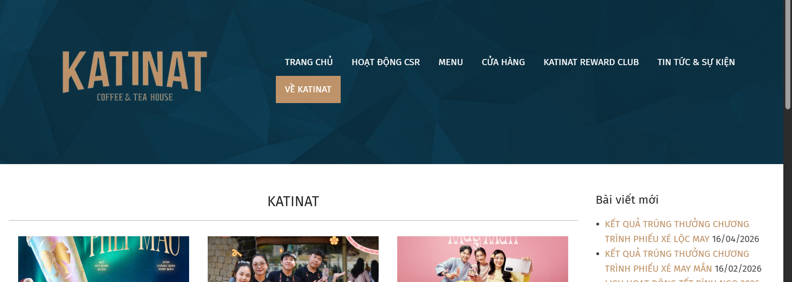

# Tài liệu Scrum - BrewLite

## 1. Vai trò
| Vai trò | Họ tên | MSSV | Phụ trách |
|---|---|---|---|
| Developer chính | Nguyễn Phạm Thái Tú | 3124410385 | Code, Docker, Git, kiểm thử tự động |
| Scrum Master | Quách Văn Trường | 3124410384 | Daily Scrum, Burndown, Review, Retrospective |
| Product Owner | Đặng Tuấn Vỹ | 3124410412 | Backlog, nghiệm thu, phản hồi |
| Tester | La Hữu Mẫn | 3122410235 | Test luồng chính |
| Tester, Reviewer | Quách Anh Vũ | 3124410410 | Test trường hợp lỗi, review Pull Request |
| Tài liệu, Demo | Trần Minh Trí | 3124410371 | README, slide, dẫn demo |

## 2. Product Backlog
| # | Task | Sprint | Điểm | Trạng thái |
|---|---|---|---|---|
| 1 | Khởi tạo dự án và cấu trúc | 1 | 1 | Xong |
| 2 | API danh sách sản phẩm | 1 | 1 | Xong |
|  | Trang Menu (Frontend) | 1 | 1 | Xong |
| 4 | Chi tiết và tùy chọn sản phẩm | 1 | 1 | Xong |
| 5 | Giỏ hàng | 2 | 1 | Xong |
| 6 | API tạo đơn hàng | 2 | 1 | Xong |
| 7 | Đăng ký / Đăng nhập JWT | 2 | 1 | Xong |
| 8 | Thanh toán không tiền mặt | 3 | 1 | Xong |
| 9 | Xác nhận, lịch sử đơn và bàn giao | 3 | 1 | Xong |
| 10 | Nghiệp vụ backend | 3 | 1 | Xong |

## 3. Sprint Backlog và Sprint Goal
- **Sprint 1** (Task 1-4): Nền tảng và hiển thị menu.
- **Sprint 2** (Task 5-7): Giỏ hàng, đặt đơn, đăng nhập. Thực tế làm theo thứ tự 5 → 7 → 6 vì Task 6 cần JWT Guard của Task 7.
- **Sprint 3** (Task 8-10): Thanh toán, bàn giao, nghiệp vụ nâng cao.

## 4. Daily Scrum

### Ghi nhận cuộc họp thứ Hai, 26/10/2026

- Thời lượng: 15 phút.
- Nội dung thực tế: trao đổi và phân công công việc cho các thành viên.
- Tiến độ tại thời điểm họp: các đầu việc mới được giao chưa bắt đầu thực hiện.

| Ngày | Đã làm | Sẽ làm | Vướng mắc |
|---|---|---|---|
| 26/10/2026 (Thứ Hai) | Đã họp nhóm 15 phút và thống nhất phân công công việc; chưa triển khai các đầu việc mới tại thời điểm họp. | Các thành viên bắt đầu thực hiện nhiệm vụ đã nhận. Trường viết unit test cho `vnd()` và `cartCount()`, theo dõi Daily và chuẩn bị Burndown. | Chưa có thông tin được xác nhận về vướng mắc trong buổi họp. |

### Cập nhật công việc thứ Ba, 27/10/2026

- Nguồn ghi nhận: nội dung 4 thành viên gửi cho Scrum Master và đối chiếu mã nguồn trên nhánh `main`.
- Đây là bản tổng hợp thông tin đã nhận. Giờ họp, thời lượng thực tế và danh sách người tham dự Daily thứ Ba chưa được cung cấp để bổ sung vào biên bản.
- Các mô tả kiểm thử dưới đây là phạm vi công việc thành viên gửi; kết quả Đạt/Không đạt hoặc PASS/FAIL chỉ được ghi nhận khi có báo cáo thực tế.

| Thành viên | Nội dung đã nhận | Đối chiếu repository | Việc tiếp theo / thông tin cần bổ sung |
|---|---|---|---|
| La Hữu Mẫn - Tester luồng chính | Hiện nhãn "Hết hàng", khóa nút "Thêm vào giỏ" khi stock = 0; kiểm thử đổi size/topping, giỏ hàng, đăng ký email mới, thanh toán Ví và "Đơn của tôi". Phạm vi nghiệm thu: Task 3, 4, 5, 8, 9. | `frontend/src/app/products/[id]/page.tsx` đã có kiểm tra `stock <= 0`, nhãn hết hàng và khóa/chặn thêm vào giỏ trên `main`. | Bổ sung bảng Đạt/Không đạt cho từng bước đã chạy và ảnh lỗi nếu có. Nội dung đã nhận chưa kèm kết quả kiểm thử từng bước. |
| Quách Anh Vũ - Tester lỗi, Reviewer | Bổ sung `backend/http/api.http`; kiểm thử đăng ký trùng email, sai mật khẩu, giỏ rỗng, mã sai/BREW10, thanh toán thành công/thất bại, dùng lại Idempotency-Key và thanh toán lại sau lỗi; review/Approve các PR. Phạm vi nghiệm thu: Task 6, 7, 8, 9, 10. | File HTTP đã có các request mẫu và kết quả mong đợi; PR #3 đã merge vào `main`. Chưa có review/Approve được ghi nhận trên GitHub ở PR #1-#4 tại thời điểm đối chiếu. | Bổ sung bảng PASS/FAIL thực tế và ghi nhận review theo phân công. Request mẫu và trạng thái PR đã merge chưa thay thế cho kết quả chạy test hoặc xác nhận review. |
| Đặng Tuấn Vỹ - Product Owner | Thêm tìm món theo tên trên Menu, lọc phía trình duyệt; nghiệm thu Task 1, 2, 3, 4, 8, 9; viết phản hồi khách hàng và backlog bản sau. | Tìm kiếm đã có trong `frontend/src/app/page.tsx`; PR #4 đã merge. Mục 10 đã có nghiệm thu sơ bộ dựa trên source, phản hồi mô phỏng và backlog. | Xác nhận kết quả chạy thực tế trước khi chốt nghiệm thu; bổ sung phản hồi thực tế sau Review nếu có. Giữ rõ phạm vi đánh giá sơ bộ của mục 10. |
| Trần Minh Trí - Tài liệu, Demo | Thêm trang 404 tiếng Việt, footer gắn vào layout; cập nhật tên/MSSV và hướng dẫn README theo thay đổi code. | `not-found.tsx`, `footer.tsx` và phần gắn Footer vào `layout.tsx` đã có trên `main`; PR #1 đã merge. README đã có tên/MSSV các thành viên và nội dung chức năng mới. | Rà soát tài liệu khớp bản demo và chuẩn bị phần trình diễn sáng thứ Tư. |

**Cập nhật phần việc Scrum Master - Quách Văn Trường:** PR #2 đã merge vào `main`, gồm 12 unit test cho `vnd()` và `cartCount()`, hướng dẫn chạy test và ghi nhận buổi họp thứ Hai. Khi tích hợp với thay đổi mới của nhóm, 12 test, lint và build đã chạy thành công. Đang tổng hợp báo cáo thứ Ba và chờ dữ liệu SP để hoàn thiện Burndown.

**Kế hoạch tiếp theo:**

1. Tổng hợp bảng kết quả kiểm thử thực tế từ Mẫn và Vũ; ghi rõ lỗi, người xử lý và bằng chứng nếu có.
2. Hoàn thiện thông tin buổi Daily thứ Ba theo thực tế, gồm thời gian và người tham dự.
3. Xác nhận Sprint đang theo dõi, story points từng hạng mục, tổng SP ban đầu và SP còn lại theo ngày để vẽ Burndown; gửi biên bản và ảnh biểu đồ cho người tổng hợp theo hạn nhóm đã chốt.
4. Chuẩn bị Sprint Review và Retrospective sáng thứ Tư, 28/10/2026; ghi kết quả sau khi các buổi họp diễn ra.

## 5. Burndown

**Trạng thái: chờ số liệu thực tế để vẽ biểu đồ.** Hiện chưa xác nhận tổng story points của Sprint và số story points còn lại theo từng ngày.

Cập nhật ngày 27/10/2026: nội dung 4 thành viên gửi chưa có bảng SP theo ngày. Danh sách nhiệm vụ và việc code đã merge không đủ để suy ra tổng SP hoặc lịch sử SP còn lại.

Story points (SP) là đơn vị nhóm dùng để ước lượng khối lượng và độ phức tạp của công việc. Nhóm cần thống nhất ước lượng cho các hạng mục trong Sprint, xác nhận ngày bắt đầu/kết thúc và cập nhật SP còn lại theo từng ngày. Cột "Điểm" (1 điểm/task) trong Product Backlog theo đề bài là điểm đánh giá, chưa có căn cứ để coi đó là story points.

Chỉ vẽ đường thực tế (Actual) khi có số liệu đã được xác nhận; chưa điền số SP hoặc tạo ảnh Burndown khi thiếu dữ liệu.

- Sprint 1: (chèn ảnh)
- Sprint 2: (chèn ảnh)
- Sprint 3: (chèn ảnh)

## 6. Sprint Review
- Sprint 1: demo menu, trang chi tiết. Phản hồi: (điền)
- Sprint 2: demo giỏ hàng, đăng nhập, tạo đơn. Phản hồi: (điền)
- Sprint 3: demo end-to-end và test. Phản hồi: (điền)

## 7. Retrospective
- Làm tốt: (điền)
- Cần cải thiện: (điền)
- Hành động lần sau: (điền)

## 8. Definition of Done
- Code chạy được, không lỗi build, đúng tiêu chí chấp nhận.
- Commit rõ ràng, được review trong nhóm.
- API có validate, UI có loading/lỗi.
- README có hướng dẫn chạy.

## 9. Ghi chú
- Task 4 commit chung với Task 5. Task 1 và Task 7 có 2 commit (backend/frontend riêng).
- Giả định (đề không quy định): giá size/topping, điểm thưởng 1 điểm/10.000đ, mã BREW10 giảm 10%, idempotency áp dụng cho POST /payments.

## 10. Nghiệm thu của Product Owner – Đặng Tuấn Vỹ

Phạm vi nghiệm thu: Task 1, 2, 3, 4, 8, 9 theo Product Backlog của đề bài BrewLite.

Đánh giá dựa trên việc rà soát source code và cấu hình repository. Các tiêu chí cần chạy thử thực tế phải được kiểm tra trước khi xác nhận hoàn tất Definition of Done.

| Task | Tiêu chí nghiệm thu | Kết quả | Căn cứ rà soát |
|---|---|---|---|
| 1 | Khởi tạo dự án, cấu trúc frontend Next.js và backend NestJS, README, Git, .env.example | Đạt | Có thư mục frontend/backend, README, file môi trường mẫu và cấu hình Docker Compose. Cần chạy thử trên máy demo. |
| 2 | API GET /products trả về danh sách sản phẩm gồm id, tên, giá và ảnh | Đạt | Backend có endpoint GET /products cung cấp dữ liệu menu. Cần kiểm tra phản hồi API thực tế. |
| 3 | Trang Menu gọi API, hiển thị sản phẩm, loading/empty state | Đạt | Trang frontend/src/app/page.tsx gọi API /products. Đã thêm ô tìm món theo tên, lọc trực tiếp trên trình duyệt và thông báo khi không có kết quả. |
| 4 | Trang chi tiết cho chọn size S/M/L và topping, tính giá theo lựa chọn | Đạt | Có trang chi tiết sản phẩm hỗ trợ chọn size, topping và tính giá. Cần kiểm thử các lựa chọn trước buổi demo. |
| 8 | Thanh toán Ví/Thẻ, gọi POST /payments, cập nhật PAID hoặc PAYMENT_FAILED | Đạt | Có chức năng thanh toán và lựa chọn phương thức. Cần chạy thử cả trường hợp thành công và thất bại. |
| 9 | Xác nhận đơn, lịch sử đơn, Docker Compose, README và demo end-to-end | Đạt | Có trang xác nhận đơn, trang lịch sử đơn, cấu hình Docker Compose và README. Cần chạy đủ dịch vụ và demo trọn luồng. |

### 10.1. Phản hồi khách hàng

Các nội dung dưới đây là phản hồi mô phỏng để chuẩn bị cho Sprint Review, không phải phản hồi đã được xác nhận từ khách hàng thật.

1. Giao diện menu hiển thị tên, hình ảnh và giá đồ uống rõ ràng. Chức năng tìm món theo tên giúp khách hàng tìm sản phẩm nhanh hơn.
2. Chức năng chọn size và topping giúp khách hàng tùy chỉnh đồ uống theo sở thích.
3. Luồng thanh toán Ví/Thẻ và màn hình xác nhận giúp khách hàng theo dõi kết quả đặt hàng.
4. Khi thanh toán thất bại, khách hàng mong muốn có thông báo rõ ràng và hướng dẫn thử lại an toàn.
5. Khách hàng đề nghị nhóm kiểm thử đầy đủ luồng đặt hàng, thanh toán và bàn giao trước khi đưa sản phẩm vào sử dụng.

### 10.2. Product Backlog cho phiên bản tiếp theo

| Ưu tiên | Hạng mục | Mục tiêu |
|---|---|---|
| Cao | Lọc menu theo danh mục và khoảng giá | Giúp khách hàng tìm đồ uống nhanh hơn. |
| Cao | Cải thiện thông báo lỗi và thử lại khi thanh toán thất bại | Giúp khách hiểu trạng thái giao dịch và hạn chế thao tác nhầm. |
| Trung bình | Lưu món yêu thích và đặt lại từ lịch sử đơn | Rút ngắn thời gian đặt hàng cho khách hàng thường xuyên. |
| Trung bình | Bổ sung kiểm thử tự động cho tìm kiếm menu và luồng đặt hàng/thanh toán | Phát hiện lỗi sớm khi cập nhật chức năng. |
| Thấp | Cải thiện khả năng truy cập và giao diện trên thiết bị di động | Giúp ứng dụng dễ sử dụng hơn trên nhiều thiết bị. |

### 10.3. Ghi chú của Product Owner

- Kết quả Đạt trong bảng là đánh giá ban đầu dựa trên rà soát source code, chưa thay thế cho kiểm thử thực tế.
- Trước khi chốt nghiệm thu, cần chạy ứng dụng, kiểm tra tiêu chí chấp nhận, lưu bằng chứng kiểm thử và xác nhận commit/review theo Definition of Done.
- Phản hồi khách hàng mô phỏng cần được cập nhật bằng ý kiến thực tế nếu nhóm đã tổ chức Sprint Review.
